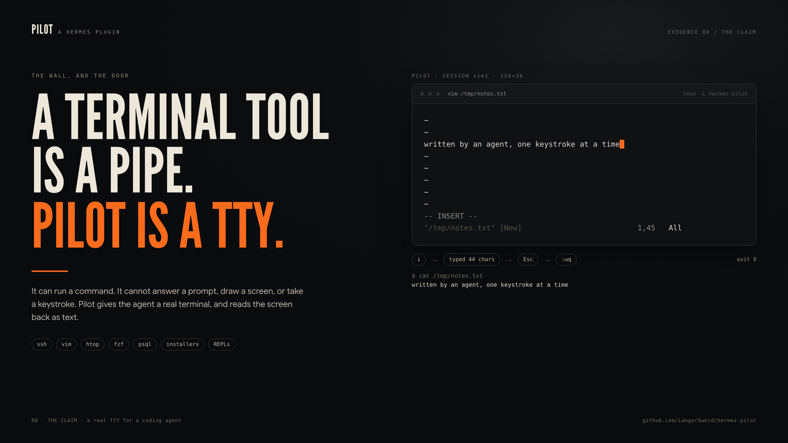

# Pilot

**Hermes can finally use programs that need a TTY.**



The terminal tool runs one command through a pipe. Anything that asks a question, draws a full screen,
or waits for a keystroke dies there: `ssh` logins, `vim`, `htop`, `fzf`, `less`, package installers,
`gh auth login`, REPLs. The workaround is `-y` flags, `yes |`, `expect`, `script -qec` — or giving up.

Pilot gives the agent a real terminal: a private tmux server, one session per task. It opens a program,
**reads the screen as text**, types literal text and named keys, waits for a pattern, and keeps the
session alive across tool calls. You can attach to the same pane and take over at any moment.

```
Name? Lakshaya
hello Lakshaya, this is a real TTY
```

```
>>> square = lambda n: n * n
>>> square(12)
144
```

```
written by an agent, one keystroke at a time
~
~
```

## What the agent gets

| action | what it does |
|---|---|
| `open` | Start a command in a new pane (`command`, `name`, `cwd`, `env`, `cols`, `rows`, `wait_for`). Returns the first screen + the attach command. |
| `screen` | Read the pane as plain text: visible screen + up to N lines of scrollback, trailing blanks trimmed. |
| `type` | Type literal `text`, press named `keys` (`Escape`, `C-c`, `Up`, `Tab`, `Enter`, …), Return by default. |
| `wait` | Poll until a regex matches, or until the pane goes quiet (`quiet_ms`), or timeout. The sync primitive. |
| `list` / `status` | Live sessions with pid, command, size, dead/pane exit status. |
| `attach` | The exact `tmux -L hermes-pilot attach -t <name>` command for the human. |
| `close` | Kill one session. |

Sessions survive between tool calls, so a REPL keeps its variables, an `ssh` connection keeps its
shell, and a half-finished `vim` buffer is still there next turn.

**As a terminal backend**, the same pane becomes the normal `terminal` tool's shell: see
[Make it the default terminal](#make-it-the-default-terminal).

## Make it the default terminal

```sh
hermes pilot backend on      # terminal.backend: pilot
# restart Hermes once, from a terminal outside the agent:
hermes gateway restart       # or: systemctl --user restart hermes-gateway
```

Every `terminal` call then runs inside a persistent tmux shell instead of a pipe:

- `cd`, exports and aliases survive across tool calls, and across turns in one session;
- `TERM=tmux-256color` and a real `/dev/pts`, so pagers, colors and curses work;
- a command that does not finish returns `exit 124` and is **left running**, with its session
  name in the output — `pilot screen` / `pilot type` can inspect or answer it;
- the next `terminal` call refuses to type into a program that is still running (`exit 126`),
  so a REPL or `vim` never receives your next `echo` by accident.

Turn it off with `hermes pilot backend off` (back to `local`).

**Caveats.** tmux must be on PATH. Terminal backends are registered by plugins when they load, so
switching `terminal.backend` needs a Hermes restart, and the plugin must run in-process
(`plugins.isolation: in_process`, the default). `execute_code` and the file tools follow the same
backend; a program left running owns the shell until you close it.

## Watch it, or take over

```sh
hermes pilot list      # name, command, pid, state, attach command
hermes pilot screen s1 # read a pane without attaching
hermes pilot attach s1 # drop into the live pane (Ctrl-b d to detach)
hermes pilot killall   # clean up
```

`/pilot` does the same inside a chat. While you are attached, everything you type lands in the same
pane — the agent's next `screen` reads it, so human and agent can co-drive one terminal.

```
name       command    pid      state  attach
live1      bash       674531   live   tmux -L hermes-pilot attach -t live1
```

## Real runs

The agent, given only the `pilot` tool:

> Use pilot to open `python3 -q` as `calc`, type `x = 6*7`, show the screen, close it.

```
>>> x = 6*7
>>>
```

> Use pilot to edit `/tmp/pilot-e2e.txt` in vim: `i`, type the text, `Escape`, `:wq`.

```
pilot was here, typed by an agent
```

That second one is a real curses program edited by keystrokes, then `cat`-verified by the agent.

## Install

```sh
git clone <this repo> ~/.hermes/plugins/pilot   # or symlink a dev checkout
hermes plugins enable pilot
```

Needs `tmux` on PATH (3.x). No Python dependencies. Hooks are live immediately; the `pilot` tool
appears in the next session (or in a new `hermes -z` run).

## How it works

* Every session runs on a **private tmux server**: `tmux -L hermes-pilot`. Your own tmux sessions are
  never listed, touched, or reused.
* `remain-on-exit` is set **before** the pane is created, so even a command that exits instantly keeps
  its final screen and its exit status (`#{pane_dead_status}`).
* `screen` uses `capture-pane -p -J`: joined lines, trailing spaces stripped, dead-pane banner removed.
  That is what a human would see, not raw ANSI.
* `wait` is what makes full-screen apps usable: redraws are asynchronous, so the agent polls for a
  pattern (or for the pane to settle) instead of sleeping blindly.
* Finished panes are kept long enough to read, then reaped by the next `open` after five idle minutes;
  `hermes pilot killall` cleans up immediately.
* Named keys are allow-listed; session names are `[A-Za-z0-9_-]{1,32}`; commands are passed as argv
  (`sh -c <command>`), never interpolated into a tmux control string.

## Limits

* Text, not pixels: it reads the terminal grid, not a screenshot. GUI apps are out.
* Full-screen programs redraw; always `wait` for a pattern before assuming the screen is final.
* A session keeps running if nobody closes it. `hermes pilot list`, then `hermes pilot killall`.
* It adds a TTY, not privilege: the agent can already run commands as you — Pilot just lets those
  commands ask questions.

## Evidence (run on this machine)

| Check | Command | Result |
|---|---|---|
| Unit tests | `python3 -m unittest discover -s tests` | **20 tests, OK** (real tmux: bash, REPL, vim, fzf, exit status, reaping) |
| Admission | `hermes plugins validate .` | **Validation passed** · security scan safe |
| Runtime doctor | `hermes plugins doctor .` | **1 tool**, discovery + import + registration passed |
| Live stdin | `hermes -t pilot -z "…read n… type Lakshaya…"` | `Name? Lakshaya` → `hello Lakshaya, this is a real TTY` |
| Live REPL | `hermes -t pilot -z "…python3 -q… x = 6*7…"` | screen shows `>>> x = 6*7` |
| Live vim | `hermes -t pilot -z "…edit /tmp/pilot-e2e.txt in vim…"` | file contains `pilot was here, typed by an agent` |
| Live fzf | `hermes -t pilot -z "…fzf… type gam… Enter…"` | picker screen read, selected `gambit` |
| Terminal backend | `_create_environment("pilot", …)` in a fresh process | `PilotEnvironment`; `echo` returns `via-backend`, cwd observed |
| Backend, fresh session | `terminal.backend: pilot` + classic CLI | `TERM=tmux-256color`, `tty=/dev/pts/N` |
| Backend, three calls | `false` / `cd /usr` / `pwd` | exit 1; cwd carried; `/usr` |
| Timeout handoff | `sleep 10` with `timeout=1` | exit 124, session left running, `pilot screen` sees it |
| Demo | `python3 scripts/demo.py` | stdin prompt, REPL, vim, fzf, htop, attach |

## Layout

```
plugin.yaml        manifest (one tool)
__init__.py        register(ctx): tool + terminal backend + /pilot + hermes pilot
pilot_tmux.py      the tmux layer: open, screen, type, wait, status, close, attach
pilot_env.py       terminal backend: persistent shell, markers, busy guard, timeout handoff
pilot_tools.py     the `pilot` tool schema + JSON handlers
pilot_cli.py       `hermes pilot` (incl. backend on/off/status) and `/pilot`
tests/             33 stdlib unittest cases (skip cleanly without tmux)
scripts/demo.py    a real-TTY demo: stdin, REPL, vim, fzf, htop
```

MIT.
