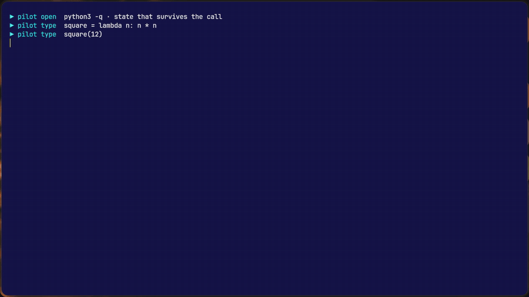
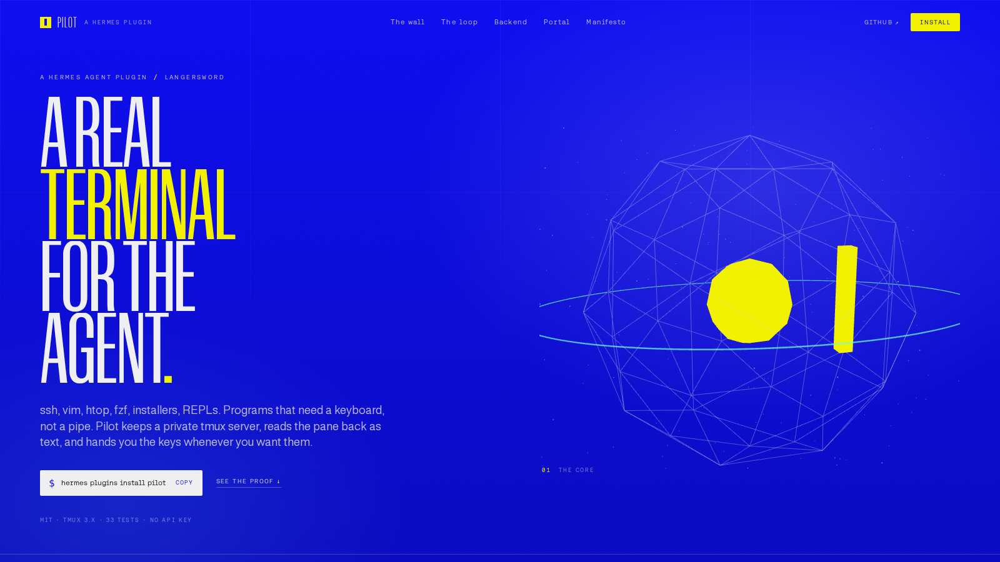
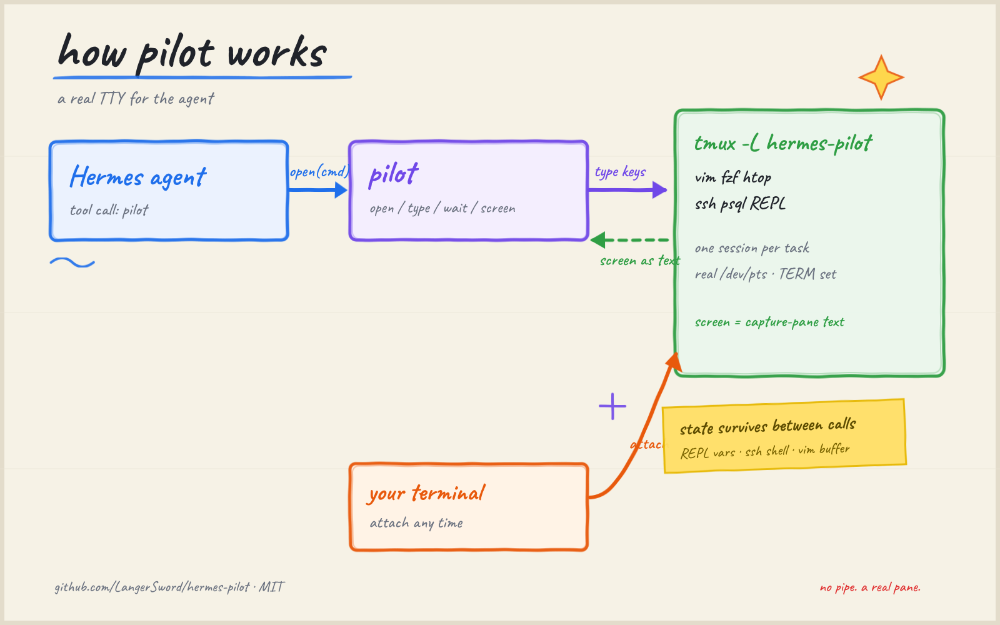

# Pilot

**A real TTY for Hermes.**

Hermes's terminal tool runs one command through a pipe. Programs that ask a question, draw a full screen,
or wait for a keystroke die there: `ssh` logins, `vim`, `htop`, `fzf`, `less`, installers, `gh auth login`,
REPLs. The usual workarounds are `-y` flags, `yes |`, `expect`, `script -qec`, or giving up.

Pilot gives the agent a real terminal: a private tmux server, one session per task. It opens a program,
reads the screen as text, types literal text and named keys, waits for a pattern, and keeps the session
alive across tool calls. You can attach to the same pane and take over at any time.

**demo:** [video](https://x.com/langersword/status/2120637238585573737) ·
**site:** [langersword.github.io/hermes-portal](https://langersword.github.io/hermes-portal/) ·
**catalog:** [PR #153787](https://github.com/NousResearch/hermes-agent/pull/153787)

If this is useful, a star helps the next person find it.

| the plugin, recorded | the page, hosted |
|---|---|
|  | [](https://langersword.github.io/hermes-portal/) |
| **recorded:** real keystrokes, 900×506 | **hosted:** GitHub Pages, 1600×900 |

## How it works



*Agent calls pilot, pilot drives a private tmux pane, the screen comes back as text, and you can attach
to the same pane at any time.*

Five decisions carry it:

- **Private tmux server** (`-L hermes-pilot`): your own tmux sessions are never listed or touched.
- **`remain-on-exit` before the pane is created**: a command that exits instantly still leaves its final
  screen and `#{pane_dead_status}` to read.
- **Text, not ANSI**: `capture-pane -p -J` returns the screen a human sees, with no escape parser.
- **`wait` before reading**: full-screen apps redraw asynchronously, so poll for a pattern or a quiet pane
  instead of sleeping.
- **argv, not interpolation**: commands go through `sh -c` as argv, named keys are allow-listed, and session
  names match `[A-Za-z0-9_-]{1,32}`.

## Tool surface

| action | behavior |
|---|---|
| `open` | start a command in a new pane (`command`, `name`, `cwd`, `env`, `cols`, `rows`, `wait_for`); returns the first screen and the attach command |
| `screen` | read the pane as plain text, visible screen plus scrollback |
| `type` | type literal `text` and named `keys` (`Escape`, `C-c`, `Up`, `Tab`, ...), Return by default |
| `wait` | poll until a regex matches, the pane goes quiet, or timeout |
| `list` / `status` | sessions with pid, command, size, dead state, pane exit status |
| `attach` / `close` | print the human attach command, or kill one session |

State survives between calls: a REPL keeps its variables, `ssh` keeps its shell, `vim` keeps its buffer.

## Terminal backend

`hermes pilot backend on` sets `terminal.backend: pilot`. Every `terminal` call then runs in a persistent
tmux shell instead of a pipe:

- `cd`, exports and aliases survive across calls and turns;
- `TERM=tmux-256color` and a real `/dev/pts`, so pagers and curses work;
- a timed-out command returns `exit 124` and is left running; `pilot screen` and `pilot type` can inspect it;
- the next call refuses to type into a running program (`exit 126`), so a REPL never receives your next echo.

Restart once from outside the agent with `hermes gateway restart`. Turn it off with `hermes pilot backend off`.

## Run it

```sh
git clone https://github.com/LangerSword/hermes-pilot ~/.hermes/plugins/pilot
hermes plugins enable pilot
hermes pilot list            # sessions, pids, attach commands
hermes pilot attach live1    # Ctrl-b d to detach
hermes pilot killall
```

Needs `tmux` 3.x on PATH. No Python dependencies. The `pilot` tool appears in the next session.
Backend switching needs a restart and `plugins.isolation: in_process` (the default).

## Limits

- Text, not pixels: it reads the terminal grid, so GUI apps are out.
- Full-screen programs redraw. `wait` for a pattern before treating the screen as final.
- An unclosed session keeps running; `hermes pilot killall` cleans up.
- It adds a TTY, not privilege: the agent could already run commands as you.

## Evidence

| check | command | result |
|---|---|---|
| unit tests | `python3 -m unittest discover -s tests` | 33 tests, OK, against real tmux |
| admission | `hermes plugins validate .` | validation passed |
| runtime | `hermes plugins doctor .` | 1 tool registered, 0 hooks |

The suite covers stdin, REPL, vim keystrokes, fzf, exit status and dead-pane reaping. `scripts/demo.py`
runs the same flow on camera.

## Stack

| component | role |
|---|---|
| Python 3 standard library | plugin, tmux wrapper, CLI |
| tmux 3.x | panes, screen capture, keys, exit status |
| Hermes >= 0.22 | plugin host, tool and terminal backend registration |

## Layout

```
plugin.yaml        manifest (one tool)
__init__.py        register(ctx): tool, terminal backend, /pilot, hermes pilot
pilot_tmux.py      tmux layer: open, screen, type, wait, status, close, attach
pilot_env.py       terminal backend: persistent shell, markers, busy guard, timeout handoff
pilot_tools.py     the pilot tool schema and JSON handlers
pilot_cli.py       hermes pilot and /pilot
tests/             33 stdlib unittest cases (skip cleanly without tmux)
scripts/demo.py    recorded demo: stdin, REPL, vim, fzf, htop
art/media/         README media: demo gif, site shot, whiteboard
```

MIT, Lakshaya Sharma ([@LangerSword](https://github.com/LangerSword)).
